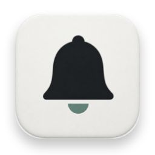
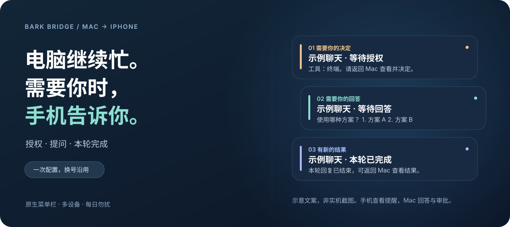

<div align="center">
  
  <h1>Bark Bridge for Mac</h1>
  <p><strong>电脑继续忙，需要你时手机提醒。</strong></p>
  <p>把 Codex 的授权、提问和本轮完成提醒，送到 iPhone Bark。<br>同一 Mac 用户共用设备配置，现有接入目录换号继续用。</p>
  <p>
    <a href="https://github.com/dneo9527-ctrl/bark-bridge-macos/actions/workflows/checks.yml"></a>
    <a href="https://github.com/dneo9527-ctrl/bark-bridge-macos/releases/tag/v2.6.0-preview.1"></a>
    <a href="LICENSE"></a>
  </p>
  <p><a href="https://github.com/dneo9527-ctrl/bark-bridge-macos/releases/download/v2.6.0-preview.1/Bark-Bridge-2.6.0-macOS-arm64-preview.zip"><strong>下载 Mac App 安装包 · 约 32 MB</strong></a> · <a href="https://github.com/dneo9527-ctrl/bark-bridge-macos/releases/download/v2.5.0-preview.1/Bark-Bridge-30s-demo.mp4">30 秒演示（v2.5 核心流程示意）</a> · <a href="docs/INSTALL.md">安装与接入</a> · <a href="docs/PRIVACY.md">隐私说明</a></p>
</div>

<picture>
  <source media="(max-width: 600px)" srcset="https://raw.githubusercontent.com/dneo9527-ctrl/bark-bridge-macos/main/docs/media/overview-mobile.svg">
  
</picture>

> **已封装为原生 macOS `.app`。** 安装后有菜单栏铃铛和独立设置窗口；Apple Silicon 安装 ZIP 内含图形安装助手及 Python 3.13.18，普通用户不用终端、Xcode 或自行装 Python。当前是 GitHub 2.6.0 预览分发，未上架 App Store，未使用 Developer ID 签名或 Apple 公证。插图和视频均为功能示意。

## 离开电脑，也知道下一步

- **需要你时提醒。** 授权、提问／选择、本轮完成三类提醒分别控制，支持带聊天名及短问题预览。
- **配置一次，现有换号继续用。** 同一 macOS 用户共用手机地址，Mac 换 Codex 账号时，iPhone Bark 无需改配置。新的独立 CODEX_HOME 需接入一次。
- **由你决定发给谁、何时安静。** 记忆多台手机，按来源分配设备；也能暂停、临时静音或设置每日勿扰。

手机负责显示提醒，实际回答和审批仍在 Mac 上完成。Bark Bridge 不改变操作授权策略，也不自动批准请求。

## 现有功能

| 你想做什么 | Bark Bridge 如何帮助 |
| --- | --- |
| 找到需要处理的聊天 | 支持的授权、提问、完成事件可带聊天名；名称无法确定时保留短编号，避免串名 |
| 看清问题与选项 | 支持短问题和选项预览；可关闭手机内容预览 |
| 选择接收手机 | 保存多台设备，独立启停，并按来源路由；指定设备已停用时跳过，不改投其他设备 |
| 少受打扰 | 全局暂停、单来源临时静音、每日勿扰，跳过后不积压补发 |
| 切换提醒场景 | “需要我时”“离开电脑”“专注片刻”；预设只组合开关，不自动检测离开 |
| 留意 Mac 电量 | 未接电源时的 20% / 10% 提醒，监听系统电源事件 |
| 知道长任务结束 | 显式包装的终端任务，以及 Mac 快捷指令末尾调用模板 |
| 保持版本更新 | 设置中检查版本，选择自动下载，校验后手动重启安装；[更新机制](docs/UPDATES.md) |
| 排查发送问题 | 按来源和结果筛选记录，查看各设备网关结果及脱敏错误类别 |

原生菜单栏支持右键铃铛暂停／恢复，设置面板可从菜单重新打开。**添加一个 .app 只是登记来源**，还需该应用提供 Hook、脚本或明确的调用入口，不会自动转发全部 macOS 通知。

## 可以接入哪些来源

| 来源 | 接入方式与验证范围 |
| --- | --- |
| **Codex** | 本机 Hook 及共享 Skill；授权、支持的提问工具和主线程本轮结束已验证。普通文字提问依赖 Skill，可能遗漏 |
| **Mac 电池** | 系统电源事件；读数和阈值规则已验证，尚未做真实放电至低电量的测试 |
| **终端任务** | `bark-run` 包装明确指定的命令，保留输出与退出码；已验证事件链路 |
| **Mac 快捷指令** | 在末尾加入模板命令；调用链路已验证，需自行配置工作流，前面的动作失败可能导致末尾动作不执行 |
| **Claude Code · 实验性** | PermissionRequest、AskUserQuestion、Stop；仅完成配置合并与隔离测试，尚未验证真实会话 |
| **其他应用** | 使用自定义调用入口；能否自动触发取决于应用是否提供事件能力 |

“本轮完成”表示主线程一轮回复结束，不表示所有后台工作或整个聊天已完成。

## 快速开始

**新用户下载：[Bark-Bridge-2.6.0-macOS-arm64-preview.zip](https://github.com/dneo9527-ctrl/bark-bridge-macos/releases/download/v2.6.0-preview.1/Bark-Bridge-2.6.0-macOS-arm64-preview.zip)**（32,031,268 字节，约 32 MB）。完整解压，双击 `Install Bark Bridge.app`，查看安装位置与 Codex 接入选项，再点击“安装并打开”，助手会安装 `/Applications/Bark.app`。解压目录内 `Start Here.html` 提供操作说明。这是已封装的 App，不需要用户编译。

| 附件类型 | 下载哪个 | 用途 |
| --- | --- | --- |
| **首次安装 · 推荐新用户** | [macOS-arm64-preview.zip](https://github.com/dneo9527-ctrl/bark-bridge-macos/releases/download/v2.6.0-preview.1/Bark-Bridge-2.6.0-macOS-arm64-preview.zip) | 已封装的 App、安装助手与内置 Python；只用于没有旧安装的 Mac |
| 程序更新 | `Bark-Bridge-2.6.0-preview.1-macOS-arm64-update.zip` | 供 2.6+ 客户端校验同一 Release 的签名清单后安装，不要自行覆盖安装目录 |
| 源码 | [Bark-Bridge-2.6.0-source.zip](https://github.com/dneo9527-ctrl/bark-bridge-macos/releases/download/v2.6.0-preview.1/Bark-Bridge-2.6.0-source.zip) | 开发、审查和自行构建，普通安装不用下载 |

`bark-update-arm64.json` 和 `.sig` 供更新客户端验证；`SHA256SUMS` 用于核对附件摘要。[完整附件与发布核验](https://github.com/dneo9527-ctrl/bark-bridge-macos/releases/tag/v2.6.0-preview.1)。

**2.6.0 起提供软件更新功能。** 设置中可检查更新、选择自动下载；自动下载默认关闭，开启后每 12 小时按需检查。下载并校验完成后仍需点击“重启并更新”才安装。更新保留设备、既有 Hook/Skill 入口及授权策略，详情见 [更新说明](docs/UPDATES.md)。

**已有安装请继续使用原 App。** 该助手只支持首次安装，检测到已有 App 或共用运行目录时会停止。已有 2.6.0+ 客户端可使用设置中的签名更新；2.4.x/2.5.x 需先按维护者指导启用可信的更新客户端。未公证包的系统提示请参考 [Apple 安全打开说明](https://support.apple.com/102445)，不修改全局安全设置。

**旧版用户不要删除设备或运行目录来强行重装。** 当前没有覆盖所有早期安装的一键迁移工具，按 [旧版维护说明](docs/INSTALL.md#已有-24x--25x-安装) 保留数据并获取针对性指导。

### 源码开发（可选）

以下仅供**从源码构建**；上面的 App 安装包用户无需执行这些命令。

**准备：** iPhone 安装 [Bark](https://github.com/Finb/Bark) 并允许通知；Mac 需要 Xcode 或 Command Line Tools、`/usr/bin/python3` 和 `curl`。测试还使用系统 OpenSSL，Python 无 pip 依赖。

### 1. 获取源码并构建

```sh
git clone https://github.com/dneo9527-ctrl/bark-bridge-macos.git
cd bark-bridge-macos
/usr/bin/python3 scripts/test.py
/usr/bin/python3 scripts/build.py
```

也可以从 [Releases](https://github.com/dneo9527-ctrl/bark-bridge-macos/releases/tag/v2.6.0-preview.1) 下载源码 ZIP，解压后进入目录。构建只生成 `build/Bark.app`，不会安装或启动。

### 2. 预览并明确安装

先确认 Codex CLI 能从 PATH 或常见 App 路径找到；如果不是，先看[自定义 CLI 路径](docs/INSTALL.md#首次安装)。

```sh
/usr/bin/python3 scripts/install.py
/usr/bin/python3 scripts/install.py --apply --codex-home "$HOME/.codex"
open /Applications/Bark.app
```

首次安装器会拒绝覆盖已有 App 或共用运行目录，不用于自动升级。遇到失败或已有安装，请按[安装与恢复说明](docs/INSTALL.md)处理。

### 3. 添加手机，确认收到测试

打开面板管理接收设备，或从右上角菜单栏铃铛进入“设置…”。将 iPhone Bark 首页的 HTTPS 推送地址填入隐藏输入框，保存并发送测试，在手机上确认收到。

**手机地址只在自己的 Mac 填写。** 不需要放进聊天、Hook 或 GitHub；源代码和发布附件不包含发布者的设备密钥。

iPhone 需安装 Bark、允许通知并保持可用网络；Wi-Fi 或移动网络下是否实际送达还取决于手机联网、APNs 和所选推送服务。离线时不保证实时收到，网关接受不等于手机实收。

[完整安装与卸载指南 →](docs/INSTALL.md) · [多账号接入 →](docs/INSTALL.md#多账号与多个配置目录) · [终端／快捷指令模板 →](docs/INSTALL.md#接入终端快捷指令与-claude-code)

## 隐私与资源

设备地址位于 `~/Library/Application Support/CodexBark`，目录权限为 `0700`，手机配置为 `0600`。不读取账号令牌，也不打开聊天正文文件来获取名称；聊天名来自本地只读名称元数据。

预览开启时，所选 Bark 服务会收到聊天名、有限长度的问题／选项或固定文案。权限提醒不发送具体授权命令，完成提醒不发送回复正文；常见密钥形式会脱敏，但不能保证识别所有敏感内容。不希望外发摘要时，可关闭“手机内容预览”。详见[隐私说明](docs/PRIVACY.md)。

菜单与电池服务常驻，设置面板关闭后退出。发送器按事件短暂运行，失败不阻塞 Codex，不长期重试；可选软件更新另按上述时间门限检查。不宣称零内存或零耗电。

## 使用前了解

- **平台：** 界面仅在 macOS 26、Apple Silicon 实机验证；构建目标为 macOS 13+，旧系统和 Intel 界面尚未实测。
- **Codex 兼容：** 已验证版本为 `0.167.0-alpha.3.2`，Hook 与信任接口可能随更新变化；云端会话不自动继承本机接入。
- **送达：** 网关接受不等于手机实收。Mac 睡眠、关机、离线、APNs 或 iPhone 专注设置都可能影响提醒。
- **分发：** 安装预览仅提供 Apple Silicon，采用 ad-hoc 签名，未使用 Developer ID 签名或 Apple 公证；首次安装与嵌入式 Python 已做隔离验证，全新 Mac 的下载隔离提示与首次打开流程尚未实机验收。Ed25519 更新签名不等于 Apple 公证；遇拦截请核对来源并参考 [Apple 安全打开说明](https://support.apple.com/102445)，不移除隔离标记或关闭 Gatekeeper。

本项目的[验证范围](docs/VERIFICATION.md)与[对应提交的 CI 结果](https://github.com/dneo9527-ctrl/bark-bridge-macos/actions/workflows/checks.yml)分别记录，不将隔离测试当作全部场景实测。

## 反馈与贡献

遇到问题，可在 [Issues](https://github.com/dneo9527-ctrl/bark-bridge-macos/issues) 描述 Mac／Codex 版本、触发场景及脱敏错误类别。提交截图前请隐藏聊天内容、设备地址和密钥。欢迎通过 Pull Request 改进兼容性、文档与测试。

本项目自己的代码采用 [MIT 许可证](LICENSE)。安装预览内嵌 Python 及依赖，来源固定于 [运行时清单](assets/python-runtime.json)，各自许可见 [第三方许可](assets/python-licenses)。独立社区工具，与 Bark、OpenAI、Anthropic 无官方关联。图标由本项目的 AI 设计流程生成并适配，不使用 Bark 官方图标。插图与视频为功能示意，非实机录屏或送达证据。
